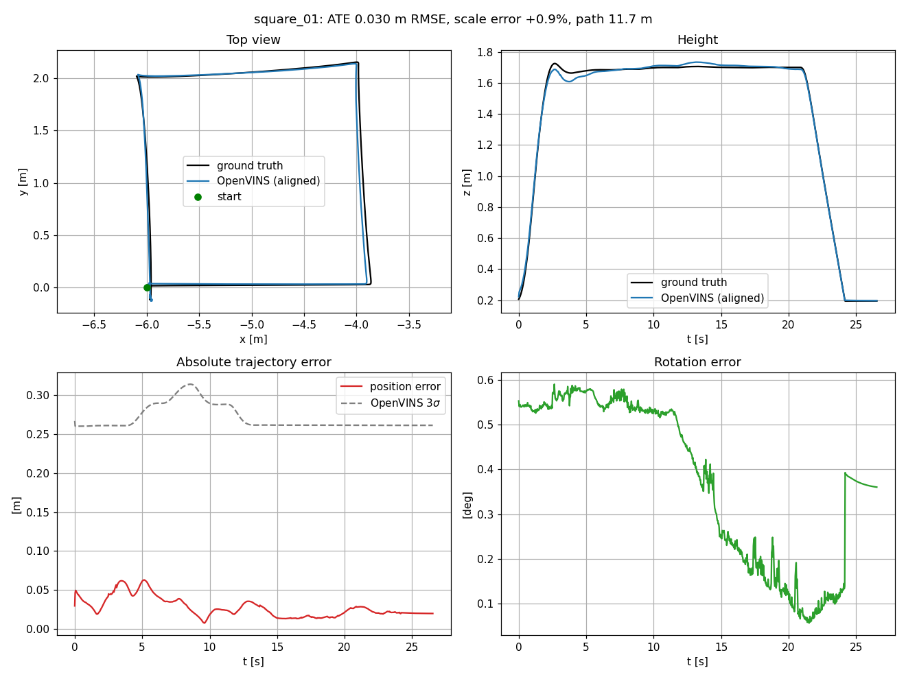

# vin_autonomy

Visual-inertial odometry (VIO) on a simulated quadcopter, and what happens to it when things go wrong.

The drone is an ArduPilot SITL iris flying in a Gazebo Harmonic warehouse. It carries a forward-facing camera and its own IMU, and [OpenVINS](https://github.com/rpng/open_vins) estimates its motion from those two sensors. Gazebo gives exact ground truth, so the estimate can be scored, and the plan is to break the inputs on purpose (timing offsets, IMU noise, dropped or dark frames) and see how the error grows. The end goal is a small health monitor that says OK / DEGRADED / LOST before the estimate actually falls apart.

## Status

Work in progress.

- [x] Sim drone with a fixed forward camera, a VIO IMU and ground truth
- [x] Camera, IMU and ground truth available in ROS 2
- [x] OpenVINS built and configured for the sim camera and IMU
- [x] Repeatable scripted test flight
- [x] OpenVINS tracking the test flight
- [x] Evaluation tool: record a run, score it against ground truth (ATE / RPE / scale)
- [ ] Baseline accuracy over a set of flights (first square: 3 cm ATE, see below)
- [ ] Bag record / replay with fault injection
- [ ] Stress tests: time offset, IMU noise, dropped frames, blur, darkness
- [ ] Downward rangefinder fused inside OpenVINS
- [ ] Loosely coupled ESKF on top of OpenVINS
- [ ] External nav into ArduPilot's EKF3, flying with GPS off
- [ ] Health monitor node and validation on the stress tests

## Layout

```
scripts/
  start_vio_sim.sh          start / stop the whole sim in terminal tabs
sim/
  models/, worlds/          the drone model and warehouse world
vin_ws/
  config/openvins_sim/      OpenVINS config for the sim camera and IMU
  src/gz_imu_bridge/        Gazebo IMU -> ROS 2 (see docs for why this exists)
  src/vio_flight/           scripted test flight over MAVROS
  src/vio_eval/             record a run, score it against ground truth
runs/                       sim logs and recorded runs (not in git)
results/                    plots and numbers worth keeping, per stage
docs/
  how_it_works.md           how the pieces fit together
  maths.md                  the bits of maths behind the config
```

## Requirements

- Ubuntu 22.04, ROS 2 Humble, Gazebo Harmonic
- ArduPilot SITL, MAVROS, `ros_gz_bridge`
- Gazebo Python bindings: `python3-gz-transport13`, `python3-gz-msgs10`
- OpenVINS built in its own colcon workspace

Some pieces live outside this repo, in the `udl_aakash` workspace on my machine, and the scripts point at them by absolute path:

- ArduPilot source and build: `udl_aakash/tools/ardupilot`
- `ardupilot_gazebo` plugin and its `iris_with_ardupilot` model
- OpenVINS workspace: `udl_aakash/vio_ws`

The drone model and world are in `sim/`. Gazebo needs to find them, so either copy them into the `models/` and `worlds/` folders of `ardupilot_gazebo` (that's where my setup runs them from) or add `sim/models` and `sim/worlds` to `GZ_SIM_RESOURCE_PATH`. The warehouse also pulls a few models from Gazebo Fuel the first time it loads.

If you're setting this up elsewhere, change the paths at the top of `scripts/start_vio_sim.sh`.

## Running it

Run these from a normal terminal. VS Code installed as a snap breaks `gnome-terminal` when launched from its built-in terminal.

Start the sim (Gazebo, ArduPilot, MAVROS, camera bridge, IMU bridge):

```bash
bash scripts/start_vio_sim.sh --start
```

Running the script with no option just prints help. It never builds anything; ArduPilot is started with `--no-rebuild`.

Check the topics are there:

```bash
ros2 topic list | grep vio
# /vio/camera/image  /vio/camera/camera_info  /vio/imu  /vio/ground_truth/odom
```

Start OpenVINS with the sim config, in another terminal, while the drone is still on the ground. It initialises on the takeoff, so if it starts mid-flight it won't initialise at all:

```bash
source /opt/ros/humble/setup.bash
source /data/projects/udl_aakash/vio_ws/install/setup.bash
ros2 launch ov_msckf subscribe.launch.py \
  config_path:=$PWD/vin_ws/config/openvins_sim/estimator_config.yaml \
  max_cameras:=1 use_stereo:=false rviz_enable:=true
```

To score the flight, start the recorder in a third terminal before taking off. It saves to `runs/eval/<name>/`:

```bash
cd vin_ws/src/vio_eval
python3 record_run.py --name square_01
```

Fly the test pattern, a 2 m square at 1.5 m facing the shelves:

```bash
cd vin_ws/src/vio_flight
python3 vio_flight.py                       # defaults
python3 vio_flight.py --side 3 --loops 2    # bigger square, twice
```

Once it has landed and disarmed, Ctrl-C the recorder (before stopping OpenVINS), then score the run:

```bash
cd vin_ws/src/vio_eval
python3 score_run.py square_01
```

This prints ATE, RPE and scale error, and writes `metrics.json` and `score.png` into the run folder. The scored section runs from OpenVINS initialising to the disarm after landing.

Stop everything and close the tabs:

```bash
bash scripts/start_vio_sim.sh --stop
```

`--stop` doesn't touch OpenVINS. Stop it with Ctrl-C in its own terminal, and if it hangs, which it sometimes does, use `pkill -x run_subscribe_m`.

## Goal so far

Get monocular visual-inertial odometry tracking a drone in a realistic SITL setup, and measure how accurate it is.

## Results so far

- **A sim drone built for VIO.** ArduPilot SITL quadcopter in a Gazebo Harmonic warehouse, with a fixed forward global-shutter camera (640x480, 30 Hz), a dedicated 200 Hz IMU and ground truth, on a new model without touching the existing ones.
- **Sensors in ROS 2.** Camera, IMU and ground truth all come through. That needed a custom IMU bridge, because the installed bridge zeroed the accelerometer.
- **OpenVINS working on the drone.** Camera intrinsics and camera-IMU extrinsics worked out by hand. Initialisation fixed (ArduPilot's smooth takeoff never triggered it), and tens of metres of drift after landing fixed with zero-velocity updates.
- **A repeatable test flight.** Scripted takeoff, 2 m square and landing over MAVROS, with retries and safe aborts.
- **An evaluation tool.** A recorder saves the estimate, ground truth, covariance and flight events in sim time. A scorer aligns the frames and reports ATE, RPE and scale error, with plots.
- **Baseline accuracy** on the first clean run (`square_01`: takeoff, 2 m square, landing; 11.7 m path, 26.5 s):

  | ATE position | ATE rotation | RPE (1 s) | Scale error | Error at landing |
  |---|---|---|---|---|
  | 0.030 m RMSE | 0.42 deg | 0.019 m / 0.13 deg | +0.9% | 0.020 m |

  That's with a perfect sim camera and IMU, so it's a best case. More in [results/baseline](results/baseline/).

  
- **A finding.** OpenVINS's own 3-sigma was about 10x the real error. The filter misjudges how much it can trust itself, which matters for anything that relies on its covariance.
- **One-command sim.** Start and stop scripts for the whole sim, plus docs on how it works and the maths behind it.

Stack: ROS 2 Humble, Gazebo Harmonic, ArduPilot SITL, MAVROS, OpenVINS, Python.

## Notes

- The sim runs at roughly 0.5x real time on my laptop (i7-13620H, RTX 3050). ArduPilot runs in lock-step, so results are still correct, just slower.
- `vin_ws/src/vio_flight/mavros_adapter.py` is copied unchanged from my `ardupilot_autonomy` project.

Co-authored with [Claude](https://claude.ai).
