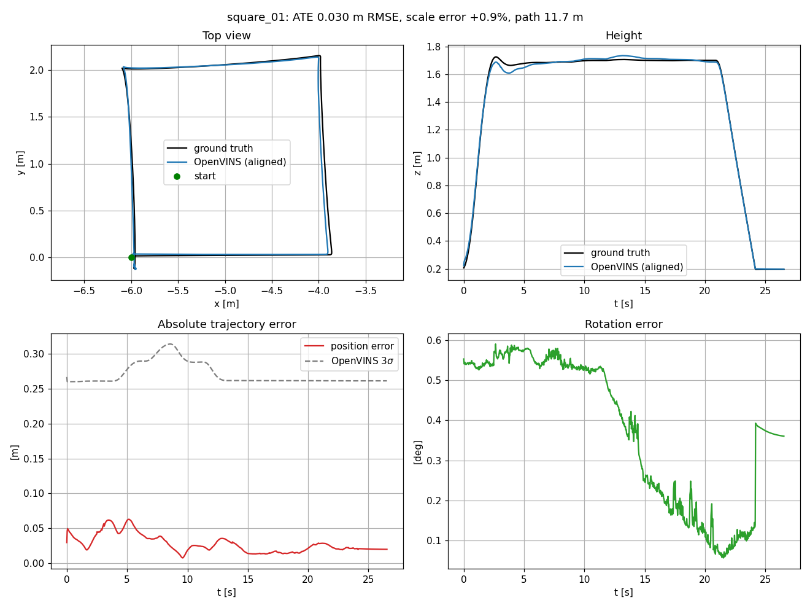

# Baseline: OpenVINS on the clean sim

Mono OpenVINS with the config in `vin_ws/config/openvins_sim/`, no sensor noise, no faults. The flight is `vio_flight.py` with defaults: take off to 1.5 m, fly a 2 m square holding heading, land. Scored with `score_run.py` from initialisation to disarm.

## square_01

11.7 m path over 26.5 s, 805 poses.

| ATE position | ATE rotation | RPE (1 s) | Scale error | Error at landing |
|---|---|---|---|---|
| 0.030 m RMSE (max 0.063 m) | 0.42 deg | 0.019 m / 0.13 deg | +0.9% | 0.020 m (0.17% of path) |

- Top left: the aligned estimate sits on the ground truth square. OpenVINS's frame came out turned 89.5 degrees from Gazebo's and the scorer removes that.
- Top right: a 7 cm dip in height just after takeoff, which is most of the position error.
- Bottom left: OpenVINS's own 3-sigma sits around 0.26 m, roughly 10x the real error. With EuRoC's IMU noise values on a perfect sim IMU, the filter thinks it's much worse than it is.
- Bottom right: rotation error jumps from about 0.1 to 0.4 degrees at touchdown, likely the ground contact jolt.

Full numbers: [square_01_metrics.json](square_01_metrics.json).
